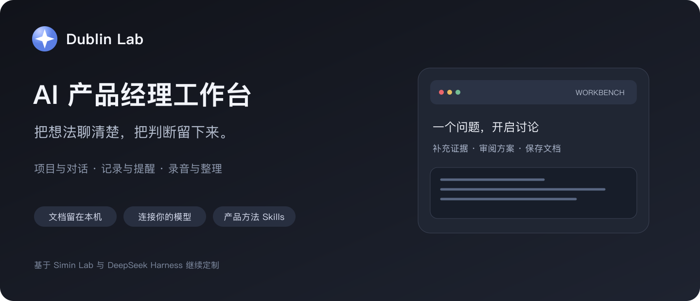
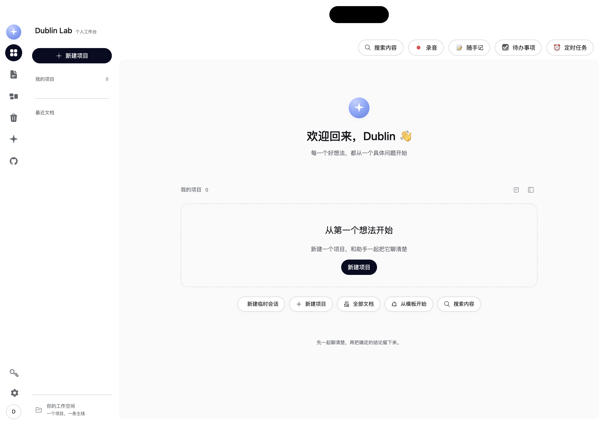
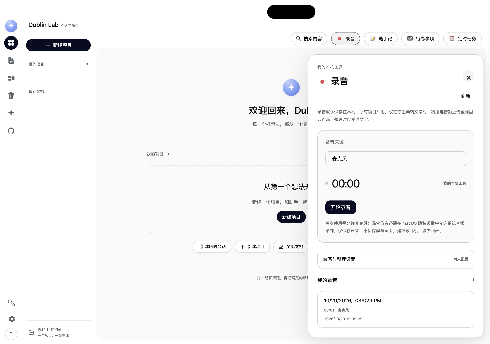
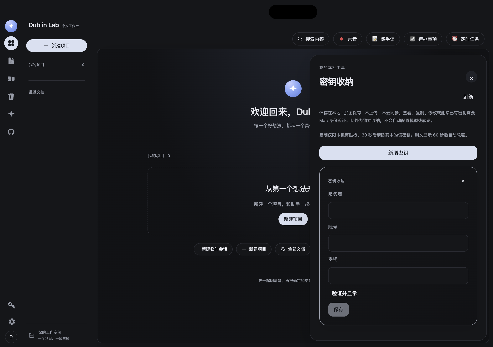

# Dublin Lab · AI 产品经理工作台



Dublin Lab 是面向个人使用的 AI 产品经理工作台。你可以围绕本地项目讨论需求、研究竞品、审阅文档，也可以直接开启一个不绑定项目的会话，随手记录想法、设置提醒或整理录音。

项目文档保存在本机。调用 AI、浏览器、GitHub 或录音转写服务时，会按具体操作访问相应的外部服务，详见[数据与隐私](#数据与隐私)。

[功能](#功能) · [界面](#界面) · [从源码启动](#从源码启动) · [数据与隐私](#数据与隐私) · [使用限制](#使用限制) · [开发与来源](#开发与来源)

## 功能

| 功能 | 可以做什么 |
|---|---|
| 项目与文档 | 创建项目和文档、阅读与搜索本地内容、围绕项目与 AI 讨论；文档修改通过现有审阅流程确认 |
| 临时会话 | 无需手动选择工作区即可聊天；关闭后仍可从历史找回，可使用已配置的工具，或归入项目继续 |
| 产品方法 Skills | 使用问题定义、用户研究、竞品分析、需求管理、优先级与范围、PRD 编写与评审等方法 |
| 浏览器工具 | 接入本机 ego-browser，供 AI 打开网页、查看内容、点击、输入与截图；需要安装浏览器并批准相关操作 |
| GitHub 热门榜单 | 默认显示本周热门，可切换每日／本月与编程语言；查看项目用途，按需翻译公开项目简介 |
| GitHub 仓库操作 | 克隆到本地、Fork 到自己的账号、创建独立副本；为有权限的仓库配置 GitHub Pages 发布来源 |
| 待办事项 | 添加、编辑、完成、删除，按未完成／已完成查看；全部项目共用 |
| 随手记 | 新增文字笔记、自动保存、查看历史笔记、编辑与删除；全部项目共用 |
| 定时任务 | 在对话中要求 AI 创建相对时间、指定时间、每天或每周的提醒；查看、编辑、暂停、恢复和取消 |
| 录音与整理 | 录制麦克风，或电脑声音与麦克风的混合音频；保存、暂停／继续、播放、拖动进度、重命名、导出与删除 |
| 音频转文字 | 保存音频后，自行选择是否调用阿里云百炼转写；显示时间戳及服务返回的匿名说话人标签，支持整理想法、会议内容和行动项 |
| 密钥收纳 | 独立保存服务商、账号及 API 密钥；卡片展开查看，默认遮罩，支持保存、复制与删除，使用本机加密存储 |
| 工作台外观 | 浅色／炭黑风格、本地背景图片、工作台和对话区各自的透明度；共用对齐的背景画布 |
| 摄像头预览 | 点击顶部黑色胶囊，授权后打开前置摄像头的本地预览；点击预览即可关闭 |

### 临时会话

“临时”表示不绑定已有项目，并不表示阅后即焚。会话记录会保留，重启后可以继续；应用会自动创建内部执行目录，因此无需你先选文件夹。访问其他本地文件仍受当前工具与审批策略约束。

选择“归入项目并继续”会保留原会话，并在所选项目中建立继承已完成历史的延续会话。空白会话或正在回复的会话不能归入项目。

### 定时提醒

例如，在标准模式对话中说：“一个小时后提醒我交文档。”以工具成功保存后返回的时间为准；定时任务面板可查看和管理规则。

应用保持运行时，到期会显示应用内提醒，并尝试发送 macOS 通知。关闭窗口与完全退出应用不同：完全退出、关机或睡眠期间不能保证准时弹出，重新运行后会补显到期提醒；循环任务只补显最近一次错过的提醒。系统通知还受 macOS 通知权限和专注模式影响。

相对时间按经过的时长计算；每天／每周规则使用创建时电脑的系统时区。VPN 的出口 IP 不决定提醒时区。

### 录音与密钥

录音结束后先保存音频，转写与整理均由你手动触发。收起面板或切换项目不会中断录制，顶部入口会显示录音状态。每段最长两小时；异常中断的录音会尝试恢复。

转写使用独立配置的百炼凭据，密钥收纳卡片不会自动变成模型配置。转写结果可复制，整理内容可保存到随手记，行动项需逐条确认后加入待办。

密钥收纳默认只显示服务商、账号和遮罩。查看、复制、修改已有密钥和删除时需要本机身份验证；明文在失焦或超时后隐藏，复制的密钥在剪贴板内容未改变时会于约 30 秒后清除。

## 界面

顶部右侧依次为“搜索内容、录音、随手记、待办事项、定时任务”。工具以右侧面板展开，保留当前工作台。录音用小红点，其余工具使用对应的简约表情，展开的大标题沿用相同标记。首页不重复展示待办或定时任务卡片。

左侧导航提供项目、文档、临时会话和 GitHub 等入口；密钥收纳位于左下角，主题和背景设置在“设置 → 外观”。

以下截图来自独立演示配置，不含个人项目、聊天或真实密钥。



<details>
<summary>录音面板与密钥收纳界面</summary>





</details>

<a id="run"></a> <a id="run-from-source"></a> <a id="run-the-desktop-app"></a>

## 从源码启动

本仓库提供源码，不附带可直接下载安装的 Dublin Lab 安装包。当前新增桌面功能以 Apple Silicon Mac 的本地验证为主。

需要 Node.js 24+、Corepack 和本机编译工具。macOS 需要 Xcode 命令行工具；仓库固定使用 pnpm 11.7.0。完整环境说明见[开发指南](docs/development.zh.md#前置条件)。

```sh
git clone https://github.com/Dublin-dd/Dublin-Lab.git
cd Dublin-Lab
corepack enable
corepack pnpm install --frozen-lockfile
corepack pnpm run build
DSH_DESKTOP_OPEN_DEVTOOLS=0 corepack pnpm run start:desktop
```

首次启动后，在“设置 → 模型与连接 → 打开设置”中配置自己的模型服务和凭据。仓库不提供 API 密钥，也不包含可供他人使用的登录状态。

日常开发可使用 `corepack pnpm run dev:desktop`；已完成构建且源码未变化时，使用 `corepack pnpm run start:desktop`。桌面应用负责启动和关闭本地服务，无需同时另开 Web 服务。

使用不带 Git 历史的源码压缩包时，构建前需设置 `DSH_CLIENT_COMMIT_HASH` 为所下载源码的版本标识；Git 克隆方式会自动获取。

### 可选服务准备

- **GitHub**：安装并登录 GitHub CLI（`gh`），实际权限以登录账号为准。仓库写入及部署操作需要在工作台确认。GitHub Pages 适合已准备好静态内容的仓库，不会自动把任意后端项目变成网站。
- **浏览器**：安装 ego-browser，并在 Host 的 `browserCli` 配置中指向其可执行文件；默认查找 `~/.local/bin/ego-browser`。浏览器工具不等于开放任意 shell 权限。
- **录音**：允许麦克风权限。电脑声音与麦克风混录还需 macOS 允许系统音频采集，并能提供系统音轨；应用不保存屏幕画面。
- **转写／整理**：在录音面板单独配置阿里云百炼区域、模型及 API 密钥。仅在主动转写时上传所选音频，整理时发送文字稿，服务费用由你的账号承担。
- **系统通知与摄像头**：按 macOS 提示授权；未授权时相应功能不可用。

## 数据与隐私

“本地保存”描述数据存放位置，不代表所有功能都离线运行。

| 数据 | 保存与发送方式 |
|---|---|
| 项目文档 | 默认保存在项目根目录下，以 Markdown／文本文件为主；源码运行通常使用 `projects/` |
| 会话与模型配置 | 由本地 Host 保存；调用模型时会向你配置的模型服务发送所需上下文 |
| 临时会话 | 自动使用项目根目录中的 `.dublin-chats/` 内部目录；会话日志仍由 Host 保留 |
| 定时任务 | 项目根目录中的 `.dublin-reminders.json`；到期通知直接发出，不再次调用 AI |
| 待办与随手记 | 当前应用配置的 localStorage，全部项目共用；清除应用浏览器数据会删除这些记录 |
| 背景与外观 | 图片保存在当前配置的 IndexedDB，外观偏好保存在 localStorage |
| 录音与转写结果 | 当前 Electron `userData` 目录下的 `dublin-tools/`；主动转写会把音频上传百炼，主动整理会发送文字稿 |
| 密钥收纳与转写凭据 | 当前 `userData/dublin-tools/` 下的本机加密文件；密钥卡片不自动同步到云端，也不自动交给 AI |
| GitHub 翻译 | 开启翻译后，公开项目简介会发送给 MyMemory 翻译服务 |
| 摄像头 | 仅在本地预览，不录制、不上传 |

源码开发配置默认位于 `apps/desktop/.desktop-build/development/`：`home/` 保存 Host 会话与配置，`electron-user-data/` 保存 Electron 应用数据。项目根目录可通过 Host 的 `projectRoot` 配置或 `SIMIN_PROJECT_ROOT` 环境变量调整。

备份时需同时考虑项目根目录、Host 数据和 Electron 应用数据；仅复制源码或推送 GitHub 不能备份聊天、录音、待办和笔记。本机加密文件也不等同于可跨电脑直接恢复的明文导出。

源码、必要资源和文档可以进入 GitHub；个人项目、会话、录音、密钥、配置、日志、安装包及备份不属于公开仓库内容。

## 使用限制

- 当前新增桌面功能主要在 macOS 本地验证；Windows／Linux 上的系统音频采集、本机身份验证及打包体验未完成同等验证。网页端会明确提示录音／密钥工具需要桌面应用。
- 本地文件、浏览器与工具调用受配置、授权和系统权限约束，安装 Skill 不会自动赋予相应执行权限。
- GitHub 热门榜单依赖网页解析，翻译受外部服务额度及网络影响；失败时保留原文或显示错误。项目用途来自作者简介，不是 AI 对仓库的完整审计。
- 音频转写与整理依赖外部模型，结果需要人工核对；说话人标签不代表真实身份识别。本仓库测试包含模拟服务和合成音频检查，不等同于所有付费模型均已做真实 API 验证。
- 本地个人打包脚本面向当前 checkout，会把构建时解析出的本地数据路径写入生成的应用；它不是通用分发安装器。这里不发布该安装包。

## 开发与来源

Dublin Lab 基于 [Simin Lab](https://github.com/chusimin/Simin-Lab) 继续定制，底层使用 [DeepSeek Harness](https://github.com/deepseek-ai/deepseek-harness)。保留上游版权与许可信息；图标相关许可见 [Heroicons](https://github.com/tailwindlabs/heroicons) 和[第三方声明](THIRD_PARTY_NOTICES.md)。

[开源许可](LICENSE) · [执行安全说明](SAFETY.zh.md) · [反馈问题](https://github.com/Dublin-dd/Dublin-Lab/issues) · [工作约定](AGENTS.md) · [架构说明](docs/architecture.zh.md) · [开发指南](docs/development.zh.md)

<details>
<summary>产品方法与源码入口</summary>

产品方法：[项目启动](.agents/skills/aipm-project-initiation/SKILL.md) · [问题定义](.agents/skills/aipm-problem-definition/SKILL.md) · [用户研究](.agents/skills/aipm-user-research/SKILL.md) · [用户分层](.agents/skills/aipm-user-segmentation/SKILL.md) · [产品拆解](.agents/skills/aipm-product-teardown/SKILL.md) · [竞品分析](.agents/skills/aipm-competitive-analysis/SKILL.md) · [需求管理](.agents/skills/aipm-requirements-management/SKILL.md) · [优先级与范围](.agents/skills/aipm-prioritization-scope/SKILL.md) · [用户旅程与协作](.agents/skills/aipm-journey-collaboration/SKILL.md) · [PRD 编写与评审](.agents/skills/aipm-prd-writing-review/SKILL.md)。另外保留开发维护类 Skills，完整目录见 [.agents/skills](.agents/skills)。

界面与交互：[ui-layout](packages/client/ui-layout/README.zh.md) · 工作区与会话：[ui-workspace](packages/client/ui-workspace/README.zh.md) · 本机服务：[web-app](packages/bundle/web-app/README.zh.md) · 桌面外壳：[desktop](apps/desktop/README.zh.md)。

仓库保留上游构建与发布工作流；GitHub 自动任务的开关状态应以仓库设置及工作流文件为准。

</details>
